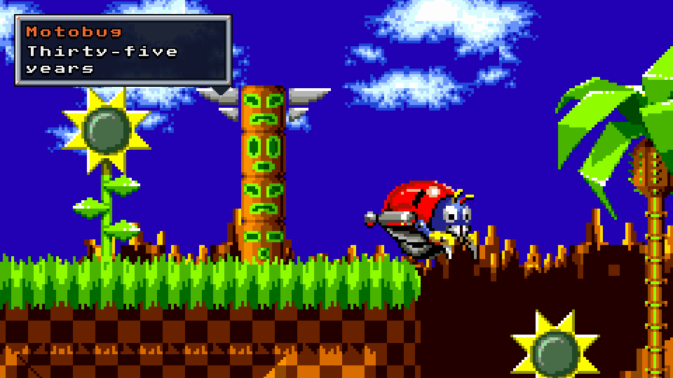

# OpenGGF features

This page lists what OpenGGF can do, with a link to the guide for each feature. It
covers version 0.7, which is still in development. Items marked "New in 0.7" aren't
in the 0.6 release. Items marked "Experimental" work, but have limits listed in their
guides and may change.

We haven't tested every feature in every game, level and setting yet.
[Game status](/docs/guide/playing/game-status) says how complete each game is, and the
[coverage backlog](https://github.com/OpenGGF/OpenGGF/blob/develop/docs/status/level-test-coverage) lists what our tests cover.

- [The games](#the-games)
- [Accuracy](#accuracy)
- [Sound](#sound)
- [Playing](#playing)
- [Display](#display)
- [Recording and capture](#recording-and-capture)
- [Level editor](#level-editor)
- [Stageplay](#stageplay)
- [Mods](#mods)
- [Time Attack and multiplayer](#time-attack-and-multiplayer)
- [Tools for developers and researchers](#tools-for-developers-and-researchers)
- [Platforms and builds](#platforms-and-builds)

## The games

OpenGGF plays three games, each from a ROM you supply.

All three run on one engine. They share the same physics, collision, camera, water
and sound code, and each game adds its own rules on top. That is why the games can
borrow features from each other, and why one level editor, one mod system and one
set of tools work for all three. We don't know of another project that runs all
three this way.

| Game | What's there |
|---|---|
| Sonic the Hedgehog | All zones and bosses, special stages, Labyrinth water, ending, credits and demos. Broadly playable from start to finish. |
| Sonic the Hedgehog 2 | All zones and bosses, special stages, Tails, Super Sonic, the original options screen and sound test, ending and credits. Broadly playable from start to finish. |
| Sonic 3 & Knuckles | Both Sonic 3 and Sonic & Knuckles, with routes for Sonic, Tails and Knuckles, Blue Sphere and all three bonus stages, the save screen and the endings. We are still testing every route and fixing differences from the original. |

The engine also has these:

- **Knuckles in Sonic 2.** New in 0.7. Choose Knuckles as Sonic 2's main character
  to play a built-in patch with Knuckles' physics, glide, climb and rearranged object
  layouts. It needs a Sonic & Knuckles + Sonic 2 lock-on dump, which is the only
  source of the Knuckles in Sonic 2 data. See [image identity](/docs/reference/configuration#image-identity)
  and the [Knuckles in Sonic 2 codes](/docs/guide/playing/controls#knuckles-in-sonic-2-title-and-sound-test-codes).
- **Sidekicks.** The games' CPU-controlled Tails follows the player, and launch
  settings choose the team.
- **Each game's own screens.** Title screens, level select, title cards, results
  and continue screens all come from the game's own data.

Sonic 2's two-player competition mode is not available yet.

## Accuracy

OpenGGF isn't an emulator. It loads levels, art and music from your ROM, but runs
our own Java version of the game code. The README explains
[how it works](https://github.com/OpenGGF/OpenGGF/blob/develop/README#how-it-works). The goal is to play exactly like the
original games.

- **Built from the original code.** We rewrote physics, collision, objects and
  bosses from the fan community's disassemblies of the original code:
  [s1disasm](https://github.com/sonicretro/s1disasm),
  [s2disasm](https://github.com/sonicretro/s2disasm) and
  [skdisasm](https://github.com/sonicretro/skdisasm). Comments in our code point to
  the matching original routines.
- **Original bugs stay in.** The engine plays like the shipped games, bugs included.
  [Known discrepancies](https://github.com/OpenGGF/OpenGGF/blob/develop/docs/status/known-discrepancies) and
  [S3K discrepancies](https://github.com/OpenGGF/OpenGGF/blob/develop/docs/S3K_KNOWN_DISCREPANCIES) list the differences we made on purpose.
- **Tests compare every frame.** Our trace tests take button presses recorded in the
  BizHawk emulator, play them in OpenGGF, and compare the two games on every frame.
  See [trace replay testing](/docs/guide/contributing/trace-replay) and the
  [trace frontier log](https://github.com/OpenGGF/OpenGGF/blob/develop/docs/status/trace-frontier-log).

## Sound

- **Each game's own sound program.** Each game had its own program for playing music
  and sound effects. OpenGGF has its own version of all three, rebuilt from the ROMs.
- **Emulated sound chips.** Sound is the one part OpenGGF emulates. It emulates the
  Mega Drive's two sound chips, the YM2612 and the SN76489. The `audio.fmCore`
  setting chooses between the default fast YM2612 and an accurate one based on
  Nuked OPN2.
- **Sound tests.** Tests compare music, sound effects and fades with the original
  games. The [audio frontier log](https://github.com/OpenGGF/OpenGGF/blob/develop/docs/status/audio-frontier-log) lists the open gaps.

See the [audio system guide](/docs/guide/contributing/audio-system).

## Playing

- **Game hub.** New in 0.7. The hub shows a shelf of game cards with each game's
  animated title logo. Pick a game, check what Start will launch, and open Game
  Setup, Recordings, Mods, Settings or Extras with a keyboard, controller or mouse.
  Pausing a game shrinks its picture into a card you can resume.
  See [getting started](/docs/guide/playing/getting-started#first-launch).
- **Game Setup and Settings.** New in 0.7. Game Setup holds per-game choices for
  players, screen shape, rewind, borrowed features and debug tools. Settings holds
  the choices for all games. Both save to `config.yaml`. See
  [configuration](/docs/guide/playing/configuration).
- **ROM discovery.** Put ROMs in a folder and the engine identifies them by their
  contents. It also accepts lock-on dumps, and separate Sonic 3 and Sonic & Knuckles
  images. See [ROM files](/docs/reference/configuration#rom-files).
- **Live rewind.** Hold a key to rewind gameplay, and the sound plays backwards.
  See [how to enable live rewind](/docs/guide/playing/configuration#how-do-i-enable-live-rewind).
- **Borrowing between games.** One game can lend features to another. Sonic 2 can
  give Sonic 1 its character art, spin dash and sound effects. Sonic 3 & Knuckles can
  give Sonic 1 and Sonic 2 its save screen, and lending its character art is
  experimental.
  Choose **Borrow from** in Game Setup. See [cross-game features](/docs/guide/playing/game-status#cross-game-features).
- **Controls.** Keyboard and standard gamepads both work. You can rebind keys,
  including chords such as `Ctrl+Shift+O`. See [controls](/docs/guide/playing/controls).
- **NTSC or PAL timing.** See [NTSC and PAL](/docs/guide/playing/configuration#how-do-i-switch-between-ntsc-and-pal).
- **Debug tools.** Overlays show sensors, hitboxes, camera bounds and objects. There
  is also an art viewer, frame stepping, zone and act skipping, and each game's own
  debug mode. See [controls](/docs/guide/playing/controls#debug-overlays).

## Display

- **Widescreen.** New in 0.7. The original games are 320 pixels wide. OpenGGF
  supports 352 and 400 pixel wide modes, and wider modes of 528 and 800 pixels are
  experimental. Our accuracy tests still use the original 320 pixel picture. See
  [wider display aspect](/docs/guide/playing/configuration#how-do-i-use-a-wider-display-aspect).
- **Window modes.** Choose windowed, borderless or fullscreen, with whole-number or
  fit scaling.
- **Colour profiles.** Choose raw RGB, a Mega Drive analog ramp or soft NTSC, plus a
  limited-range option. See [less bright colours](/docs/guide/playing/configuration#how-do-i-make-colors-less-bright).
- **Your own display shaders.** The engine loads shaders from a `shaders/` folder, and
  you can switch between them in game. See the
  [display shader library](/docs/reference/configuration#display-shader-library).

## Recording and capture

- **Live recording.** Press `Shift+O` to record the game view to a lossless video
  file with FFV1 video and FLAC audio. Recordings include rewinds. You can also take
  screenshots. See [capture](/docs/reference/configuration#capture).
- **Input recordings.** Press `Shift+F9` to record your input, then play it back from
  the hub's **Recordings** menu with fast-forward and desync checks.
- **Offline capture tools.** These tools render a gameplay section or a trace replay
  to video without opening a window. See the `gameplay-capture` and `trace-capture`
  skills in `.agents/skills/`.

## Level editor

Experimental. Build playable levels for Sonic 1, Sonic 2 and Sonic 3 & Knuckles from
ROM assets. You can paint foreground and background, compose blocks and chunks,
assign collision, place objects and rings, and set a level's properties. A failed
save keeps the previous project file. Playtests run on a fresh copy of the level and
return you to the editor, and you can export levels for use in mods. The editor works
with a controller or a keyboard.

It does not paint pixel art or edit the games' scripted events and bosses. See the
[level editor guide](/docs/guide/creating/level-editor). When you install the optional
desktop app [OpenGGF Editor](https://github.com/OpenGGF/OpenGGF-Editor), it replaces
the built-in editor interface.

## Stageplay

New in 0.7. Experimental. Stageplay makes short films and cutscenes with the games'
characters.

Cast Sonic, Tails, Knuckles and the games' badniks, animals and bosses, and put them
in any level. Then direct them. You choose where they go, when they jump, what they
say, where the camera looks and what music plays. Characters move with the games' own
physics, and the Genesis sound chip voices their dialogue. You can direct a scene in
the engine by pressing `F4` in the level editor, in OpenGGF Editor, or as a text
screenplay. Export the scene as a lossless film, or play it as a cutscene in a mod.

Start with [the Stageplay guide](/docs/guide/creating/stageplay) and
[your first film](/docs/guide/creating/stageplay-first-film), or read
[how Day Off was made](/docs/guide/creating/stageplay-day-off).

## Mods

New in 0.7. Experimental. The mod API isn't final yet and may change before we
publish it.

To change the original games, people patch assembly code inside the ROM. An OpenGGF
mod is ordinary Java code instead. It holds only its own code and data, and loads the
art and music from the player's ROM, so you can share it without sharing Sega's files.

- **Mod Manager.** The hub's Mod Manager installs, orders, enables and disables mods.
  It asks you to trust a mod before running its code.
- **What mods can do.** Mods can replace music, reskin objects, add objects,
  characters, zones and whole campaigns, edit stock levels, or replace the whole
  screen with a different game that still uses the ROM's art and music.
- **The `ggfmod` tool.** It converts, checks and packages mods.
- **Builds.** Every build loads mods, including mods that contain code.

Start with the [mod creator handbook](https://github.com/OpenGGF/OpenGGF/blob/develop/docs/modding/index) or
[installing mods](https://github.com/OpenGGF/OpenGGF/blob/develop/docs/modding/installing-mods).

### Example mods

The [`examples/`](https://github.com/OpenGGF/OpenGGF/tree/develop/examples/) folder holds complete mods that use the API.

| Mod | What it is |
|---|---|
| [Act Practice](https://github.com/OpenGGF/OpenGGF/blob/develop/examples/act-practice/README) | Timed first-act runs with retries and a ghost of your last attempt |
| [Eggman's Sky](https://github.com/OpenGGF/OpenGGF/blob/develop/examples/eggmans-sky/README) | Space exploration across planets remixed from your ROMs' zones |
| [Emerald Remix](https://github.com/OpenGGF/OpenGGF/blob/develop/examples/emerald-remix/README) | Sonic 2 with a remixed Emerald Hill and a new act |
| [Flappy Tails](https://github.com/OpenGGF/OpenGGF/blob/develop/examples/flappy-tails/README) | One-button flying through five S3K zones |
| [Hello Scene](https://github.com/OpenGGF/OpenGGF/blob/develop/examples/hello-scene/README) | The smallest full-screen mod, to start your own |
| [Infinite Sonic](https://github.com/OpenGGF/OpenGGF/blob/develop/examples/infinite-sonic/README) | Endless courses built from Sonic 1's zones |
| [Mutator Lab](https://github.com/OpenGGF/OpenGGF/blob/develop/examples/example-mutators/README) | Eleven gameplay modifiers for all three games |
| [Putt Putt Paradise](https://github.com/OpenGGF/OpenGGF/blob/develop/examples/putt-putt-paradise/README) | Sonic 2 mini golf, with multiplayer |
| [Robotnik Tower Defence](https://github.com/OpenGGF/OpenGGF/blob/develop/examples/robotnik-tower-defense/README) | Tower defence with badniks guarding Robotnik's base |
| [Second Strike](https://github.com/OpenGGF/OpenGGF/blob/develop/examples/second-strike/README) | A prototype of a harder S3K campaign |
| [Sitar Hero](https://github.com/OpenGGF/OpenGGF/blob/develop/examples/sitar-hero/README) | A rhythm game on your ROMs' music, with co-op, duels and direct-connect matches |
| [Slay the Robotnik](https://github.com/OpenGGF/OpenGGF/blob/develop/examples/slay-the-robotnik/README) | A deck-building roguelike on S3K |
| [Sonic Survivors](https://github.com/OpenGGF/OpenGGF/blob/develop/examples/sonic-survivors/README) | A survivors-style roguelike on Sonic 2 |
| [Sonic3K Chaos Mode](https://github.com/OpenGGF/OpenGGF/blob/develop/examples/sonic3k-chaos-mode/README) | Random timed effects during an S3K playthrough |
| [Stageplay demo](https://github.com/OpenGGF/OpenGGF/blob/develop/examples/stageplay-demo/README) | A Stageplay scene played as a mod cutscene |
| [Starfall Frontier](https://github.com/OpenGGF/OpenGGF/blob/develop/examples/starfall-frontier/README) | Mining, crafting and building on Angel Island |
| [Starpost Valley](https://github.com/OpenGGF/OpenGGF/blob/develop/examples/starpost-valley/README) | A farming life game set after the credits |
| [Super Sonic Bros.](https://github.com/OpenGGF/OpenGGF/blob/develop/examples/super-sonic-bros/README) | A platform fighter for one to four players |
| [Three Islands](https://github.com/OpenGGF/OpenGGF/blob/develop/examples/three-islands/README) | A turn-based RPG across all three games |
| [Typing of the Hedgehog](https://github.com/OpenGGF/OpenGGF/blob/develop/examples/typing-of-the-hedgehog/README) | Type words to defeat badniks |

## Time Attack and multiplayer

New in 0.7. Experimental. Time Attack is a bundled mod. Open it from
**Extras > Time Attack**.

- **Solo runs.** Time your runs, retry instantly and race ghosts of your best times.
- **Racing.** Host or join races on your local network, or browse public and private
  rooms on a master server. Every player needs the same engine build and ROM.
- **Chat.** Players can chat, and an optional filter masks profanity.

Time Attack comes with every build, including the native packages. See
[Time Attack](/docs/reference/configuration#time-attack-bundled-mod).

## Tools for developers and researchers

- **Headless engine tests.** JUnit tests run real gameplay without a window. See
  [testing](/docs/guide/contributing/testing) and [headless testing](/docs/guide/contributing/headless-testing).
- **Trace replay and visual trace test mode.** Compare the engine with BizHawk
  recordings in tests, or watch a replay in the engine. The recording tools live in
  [TraceChaser](https://github.com/OpenGGF/TraceChaser), an optional submodule.
- **ROM tools.** Find and verify ROM offsets, test decompression and inspect art load
  lists. See [tooling](/docs/guide/cross-referencing/tooling).
- **Cross-referencing guides.** These guides map the engine to the disassembly. Start
  with [how the engine reads ROMs](/docs/guide/cross-referencing/how-the-engine-reads-roms).
- **Agent workflows.** Skills and procedures for AI coding agents that work on the
  project live in `.agents/skills/` and [`docs/agent-workflow/`](https://github.com/OpenGGF/OpenGGF/tree/develop/docs/agent-workflow/).

## Platforms and builds

- **Operating systems.** OpenGGF runs on Windows, macOS and Linux, on any system with
  an OpenGL 4.1 driver.
- **Native packages.** Packages for Windows x64, Linux x64 and Apple Silicon macOS
  need no Java install. They load mods that contain code and include Time Attack.
  This support is new, so a mod that relies on unusual Java features may still need
  the `.jar` build.
- **The JVM build.** The `.jar` build needs Java 25. It runs on every platform,
  including Intel Macs.

See [getting started](/docs/guide/playing/getting-started) to install, or
[dev setup](/docs/guide/contributing/dev-setup) to build from source.
