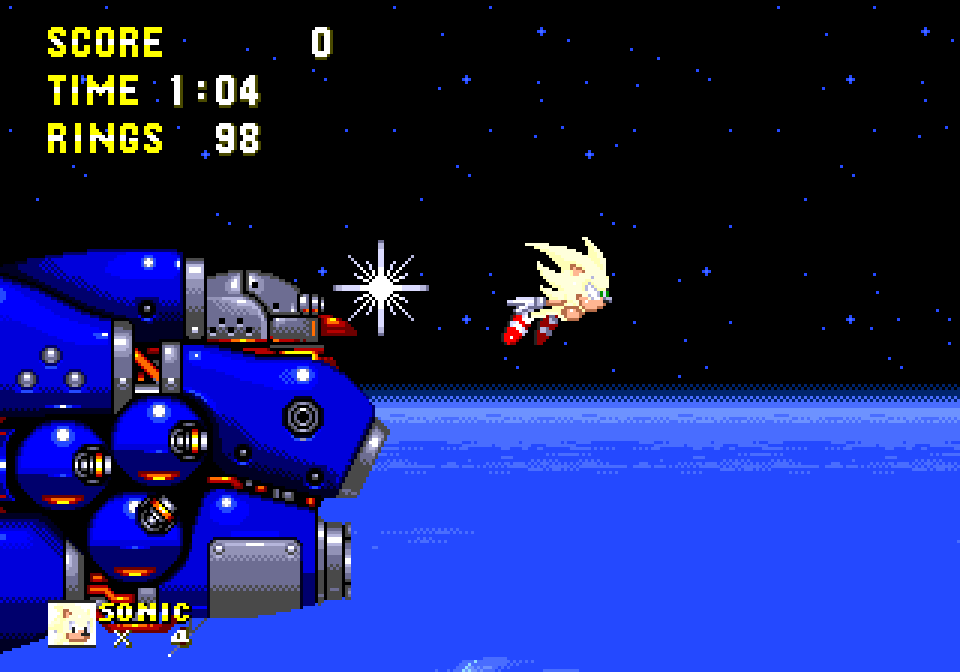
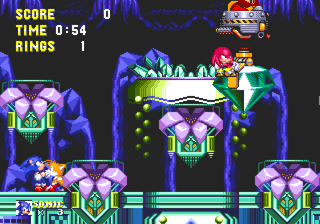
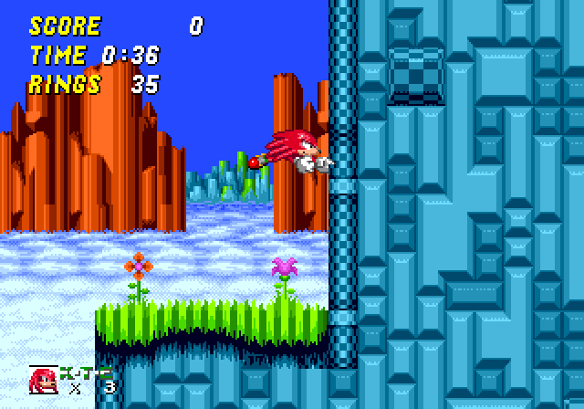
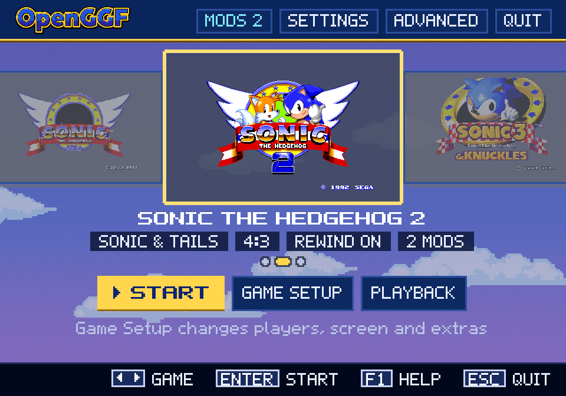
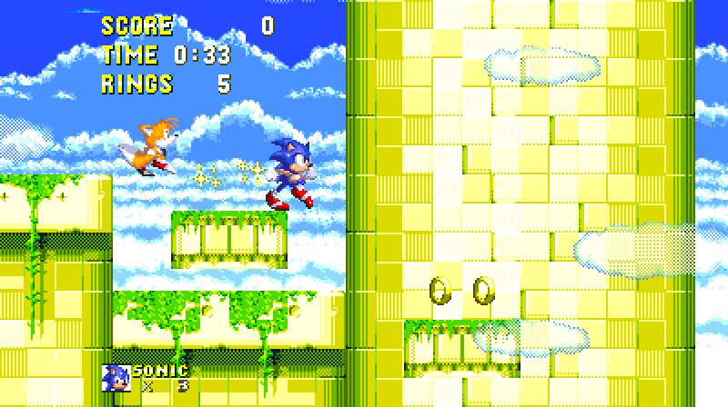
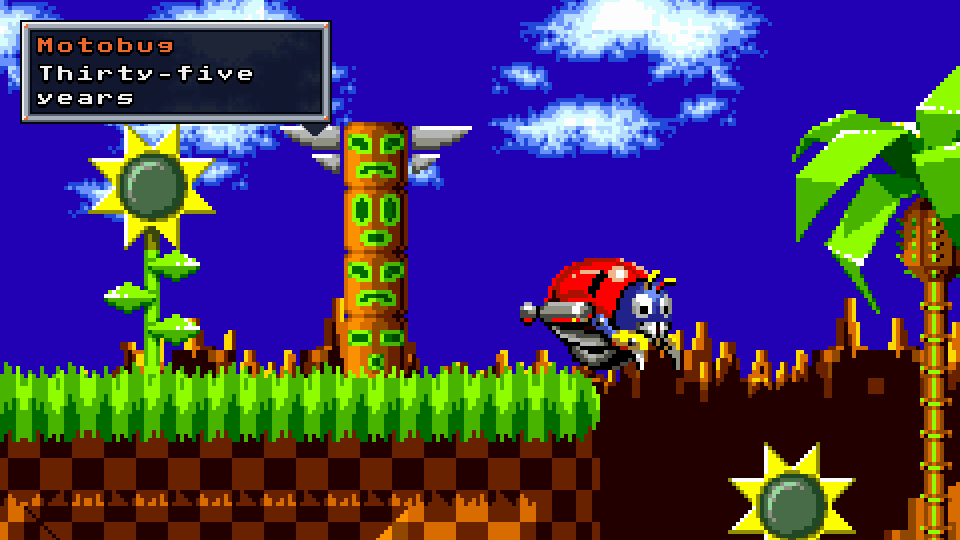

OpenGGF 0.7 is out. OpenGGF is the fan-made engine that plays Sonic the Hedgehog, Sonic 2
and Sonic 3 & Knuckles, rebuilt in Java and running from your own dumps of the cartridges.
It isn't an emulator: the games' code has been rewritten, and the Mega Drive's sound chips
are the one emulated part.

0.6 got Sonic 3 & Knuckles from Angel Island to Hydrocity. 0.7 takes it the rest of the way
around the map.

## Sonic 3 & Knuckles, through to the endings

Every zone of the locked-on game now has a playable implementation, from Marble Garden to
The Doomsday Zone. The late game is the big one. Sky Sanctuary has its three boss fights, two rebuilt
Robotnik ships and then Mecha Sonic himself, each taking eight hits. Death Egg Act 2 flips gravity, so you run on
the ceiling. In Doomsday, Sonic falls in, transforms (Hyper with all the Super Emeralds) and
flies the asteroid field under Robotnik's ship.

All three characters reach their native endings. Sonic and Tails go from Death Egg or
Doomsday to the Tornado rescue and the credits. Knuckles goes from his final Sky Sanctuary
fight to his plane flight and island credits. Hidden Palace's save slot now takes you to the
playable Hidden Palace act, not the Super Emerald shrine.

Sonic 3 & Knuckles is still **in beta**. Most of it plays as Sonic, Tails and Knuckles, but we
haven't yet certified a complete run for any character, and we're still testing each route
and fixing differences from the original.

## Sonic 1, Sonic 2 and Knuckles in Sonic 2

Sonic 1 and Sonic 2 play from start to finish, endings and credits included. Both now
recognise their original REV00 cartridges as well as REV01, and use that revision's own data
and behaviour.

Pick Knuckles in Sonic 2 and you get Knuckles in Sonic 2 as the lock-on cartridge played it:
his own physics, gliding and climbing, and its rewritten object layouts. It needs your Sonic 3 & Knuckles and Sonic 2 dumps. If you also have the S&K + Sonic 2
lock-on dump, OpenGGF reads the lock-on chip's own art and palettes too.

## A new front door

The title screen is now a cartridge shelf. Each game's card shows its original animated logo,
and if a ROM is missing, the card names it. Game Setup holds the choices for one game, Settings
holds the choices for all of them, and the menus offer 20 language choices. The translations
are machine drafts, and the menu says so.

OpenGGF recognises ROMs by their contents, not their file names, and accepts lock-on dumps.

## Widescreen and smoother motion

352- and 400-pixel widescreen are supported across levels, menus, results, endings and every
game's special stages. 528 pixels is best-effort and 800 is exploratory. Gameplay still
follows the original 320-pixel screen, so a wider view shows more of the level without
changing how it plays.

Gameplay now runs at 60 Hz (50 Hz for PAL) whatever your monitor's refresh rate. On a
59.94 Hz display, the default pacing can lock to the refresh, so the picture no longer repeats
a frame now and then. Motion interpolation for high-refresh displays is there if you want it,
and off by default.

## Rewind, Stageplay, the editor and Time Attack

- **Rewind** now has a budget, 10 seconds by default, refilled at checkpoints, acts or zones
  (or set it to unlimited).
- **OpenGGF Stageplay** is new: direct short films and cutscenes with the games' own
  characters and physics, then export them to video with FFmpeg. It's **experimental**.
- **The level editor** can now create, save and reopen named level projects in all three
  games. It's **experimental** too.
- **Time Attack** ships as a bundled mod with ghosts, retries and online racing, under
  Extras > Time Attack.

## Mods: a preview

0.7 includes the mod framework, from music packs to whole new games, but the **Mod API is a
preview**. It isn't published yet and can still change; it's published in 0.8. The example
mods in the repository are examples of what the framework can do, not releases.

## What moved to 0.8

We planned 0.7 as the release where all three games were complete and qualified. It isn't
that, and we've said so in the release notes. Complete, certified Sonic 3 & Knuckles runs for
Sonic, Tails and Knuckles, the four full-game replay checks against the original and a
whole-game sign-off all move to 0.8. The
[release summary](https://github.com/OpenGGF/OpenGGF/blob/master/docs/changelog/v0.7-release-summary.md)
lists every one.

## Get it

Download OpenGGF for Windows or Linux from the
[download section](https://openggf.com/#download), or find every package on the
[GitHub releases page](https://github.com/OpenGGF/OpenGGF/releases). Those packages don't need
Java. The macOS package isn't ready yet: on a Mac, run the universal JAR with Java 25
(`java -XstartOnFirstThread -jar OpenGGF-universal.jar`). You'll need dumps of games you own:
OpenGGF contains no game files, art or music.

*OpenGGF is a fan project with no connection to Sega. Sega has not sponsored, approved or
endorsed it. Sonic the Hedgehog and all related characters, names and trademarks belong to
Sega Corporation.*

## And then, 0.8

From 1 December we're opening one door a day, 25 in all, each showing a part of OpenGGF
as it stands in 0.7, and a few things 0.8 adds. OpenGGF 0.8 is out 25 December.
